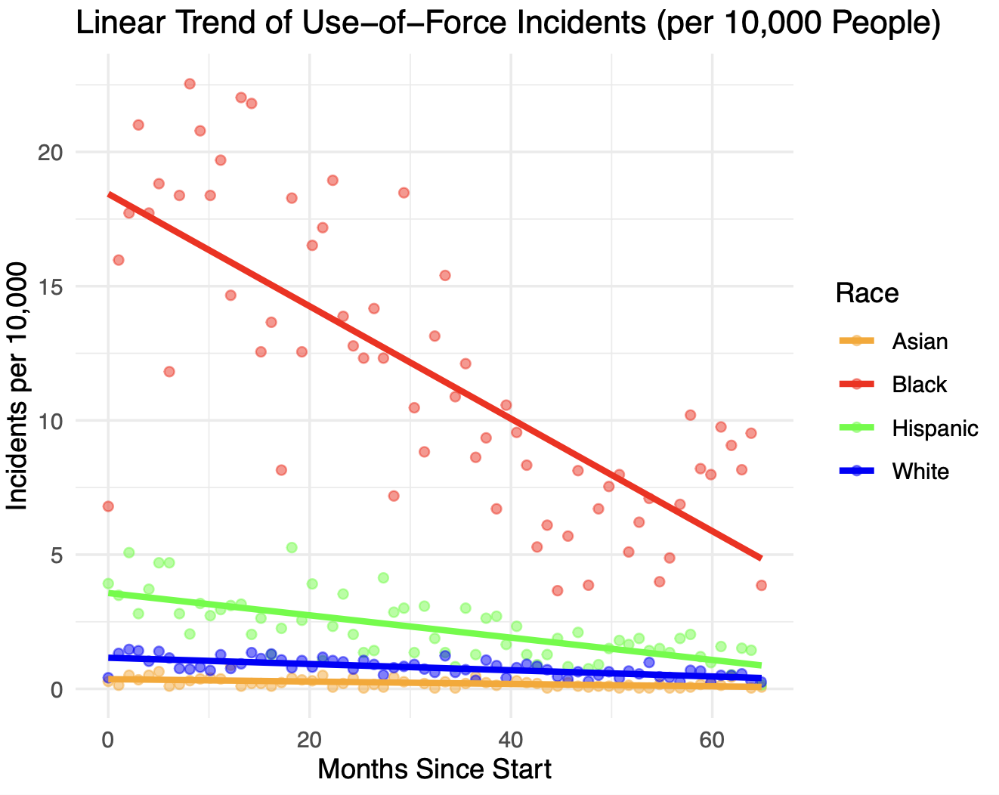
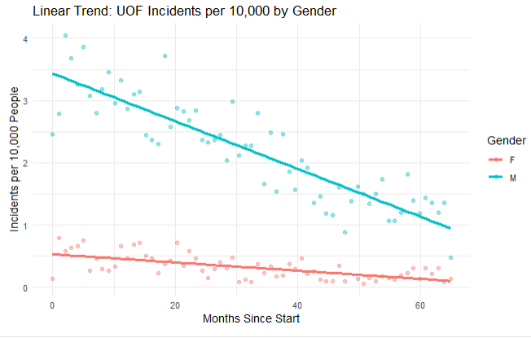
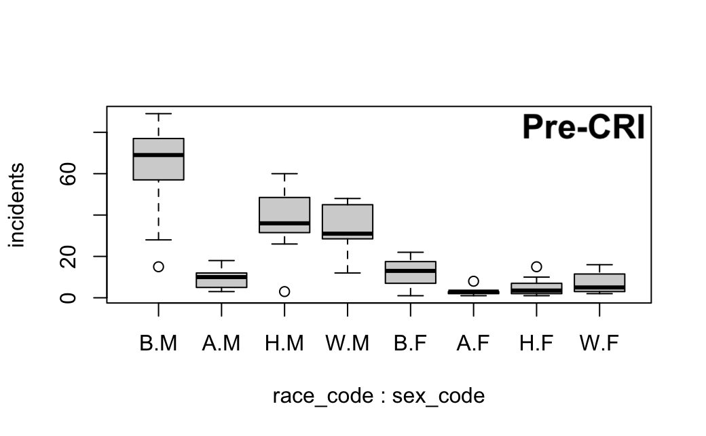
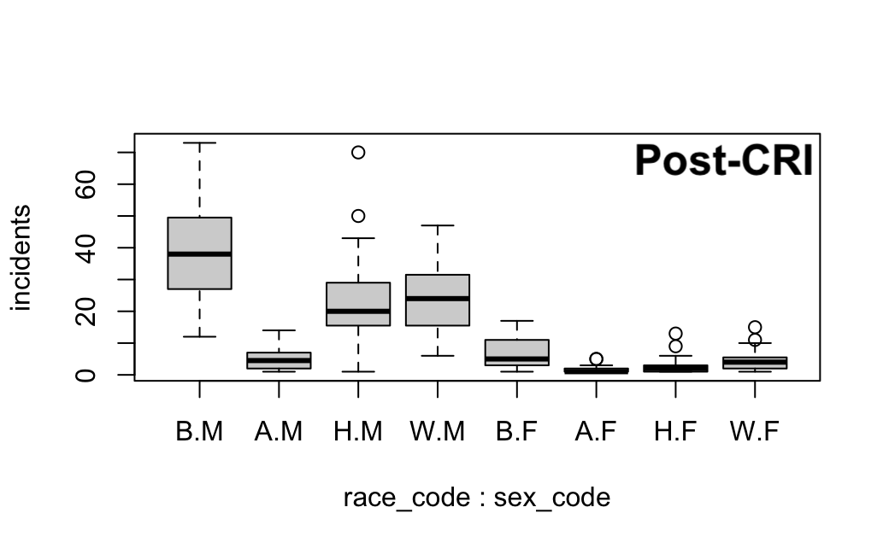
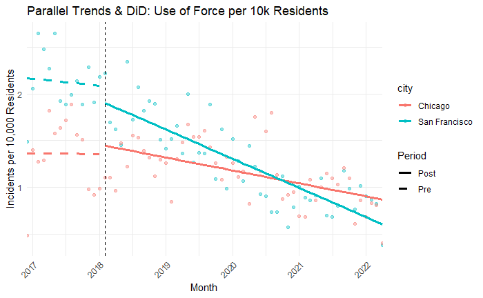

**Tianyi Gao1, Amber Wang2, and Emily Xie3**

1Leland High School, iangao0903@gmail.com

2The Harker School, amber.wang.349@gmail.com

3Diamond Bar High School, emilyxie666@gmail.com

# Abstract

Following harsh criticism of its use of force (UOF) policies, the San Francisco Police Department (SFPD) implemented sweeping changes as a part of its Collaborative Reform Initiative (CRI). While SFPD reports state that total UOF incidents decreased, research gaps remain, such as the lack of an independent, causal analysis into whether the recommendations effectively reduced race and gender UOF disparities. The present study analyzes how SFPD policy reform changed the type of force exerted against different demographic groups, using three types of statistical analysis: linear regression models to visualize demographic trends in UOF, a logistic regression model to analyze the distribution of UOF severity among different groups, and a difference-in-differences approach using Chicago as a control group to determine the CRI’s causal effect. We find that the CRI caused a statistically significant reduction in UOF incidents in San Francisco, suggesting that the CRI’s major reforms should be implemented in police departments nationwide.

**Keywords:** law enforcement, police reform, police brutality, regression, difference-in-differences, Chicago

## I. Introduction

Police use of force (UOF), defined by the International Association of Chiefs of Police as the “amount of effort required by police to compel compliance by an unwilling subject,” has generated controversy in American society for decades (“Police Use of Force,” 2001, p. 12). Across the US, excessive UOF has been found to disproportionately affect people of color (Schuck, 2004; Geller et al., 2020; Graham, 2024; Smith & Holmes, 2014). In particular, Black men are the group most targeted by UOF (Edwards et al., 2019; Terrill & Mastrofski, 2002).

Gilbert & Ray (2015) view racial bias in law enforcement through the lens of the Critical Race Theory, the conceptual framework that racism is heavily embedded into many Western institutions which were historically built for and by white people. Furthermore, Lee (2024) highlights that American law enforcement has long been influenced by centuries of discrimination; modern-day policing originated from 18th- and 19th-century slave patrols and Jim Crow-era police who enforced segregation, often violently. Building on this legacy of racialized policing, the 2010s saw a resurgence of public attention to police brutality, with the widely reported deaths of Eric Garner, Michael Brown, and Freddie Gray increasingly eroding public trust in law enforcement (“A Decade,” 2020; Premkumar et al., 2021). Protests against the police prompted federal agencies and local departments to more seriously consider reforms and initiatives aimed at curbing racial bias (Gately & Stolberg, 2015).

One agency that experienced drastic reform was the San Francisco Police Department (SFPD). Outrage over the death of Mario Woods, a black man who was shot at least 21 times by police for being suspected of assault and holding a knife during the confrontation triggered a United States Department of Justice (DOJ) investigation in 2016. The investigation found that the UOF incidents perpetrated by the SFPD were disproportionately against people of color (Queally & Monzingo, 2016), and so the city launched a project called the Collaborative Reform Initiative (CRI) with the DOJ to address this issue. The goal of the CRI was to fulfill the 272 recommendations, including UOF, bias, community policing, and accountability reforms made by the DOJ (“Police Reform,” n.d.). In its report, the DOJ noted that, “If the SFPD \[completes the CRI\] – with sustained diligence and in good faith – it will become a model policing agency in this country” (“An Assessment,” 2016, p. 224).

Though the DOJ soon withdrew from the CRI and terminated its assistance to San Francisco, on February 5, 2018, the city entered a partnership with the California Department of Justice (CADOJ) to fulfill the former’s goals of reducing UOF encounters, rebuilding public trust, and bringing accountability to the police through policy reforms (“Historic Police Reform Milestone,” 2024). The reforms included de-escalation training, making the pointing of a firearm a reportable UOF incident, and the use of shields as a form of de-escalation. By January 2025, 245 of the 272 recommendations had been found in substantial compliance (San Francisco Police Department, 2025).

The CRI was divided into three phases of implementation, with official reports published after each one. Notably, the second report, released in March 2020, stated that the SFPD had experienced a 24% decrease in the number of UOF incidents since the previous year and a 47% decrease since December 2016 (“PHASE II,” 2020). These descriptive statistics were attributed to the CRI, however, without a statistical analysis of the initiative’s exact causal effect. Moreover, besides these phase reviews commissioned by the SFPD, there has been a significant lack of objective and quantitative CRI evaluation. In light of these research gaps, it is imperative to address whether the SFPD’s policy reforms reduced UOF disparities among different demographic groups in order to understand whether the CRI has truly transformed the SFPD into a “model policing agency,” in the words of the DOJ, or whether San Francisco’s work in reducing the inequality present in UOF is still incomplete.

In our project, we utilize a quasi-experimental research design to analyze the effect of the CRI on UOF incidents in San Francisco from December 2016 to April 2022, with a focus on the question, “How have the policy changes outlined in the CRI changed the number and severity of UOF incidents directed by the SFPD towards individuals, considering the subject’s race and sex?” Our hypothesis is that the policy reforms of the CRI reduced the number of incidents and the severity of force greatly across all demographics but especially for more targeted groups, such as Black men.

This study consists of three major models. The first are a series of Linear Regression Models which examine incident changes over time by demographics and with interaction terms. The second is an Ordinal Linear Regression Model that predicts probabilities of UOF severity among different groups before and after CRI. LAstly, the third model is a Difference-in-Differences (DiD) comparison between the SFPD and the Chicago Police Department (CPD) to isolate the treatment effect of the CRI, controlling for potential changes to policing patterns from national shocks like the Black Lives Matter (BLM) movement and Covid-19.

## II. Methodology

## A. Data Collection

We sourced our data from two city-wide datasets. The first, which contains all UOF incidents (n=8203) reported by the SFPD from December 21, 2016 to April 11, 2022, comes from San Francisco’s official open data program, DataSF (DataSF, n.d.). Additionally, to compare San Francisco against Chicago, we used a publicly available Chicago Police dataset of UOF incidents as a control (*Use Of Force Dashboard*, 2025). From the Chicago dataset, we removed all rows containing occurrences outside the timeframe of the San Francisco data, leaving n=34162 occurrences. We extracted variables including the UOF incident date, the subject’s race, and the subject’s sex. To analyze the data, we utilized the integrated development environment RStudio.

## B. Linear Regression Models

**Demographic Trends Over Time**

We further analyzed how the number of UOF incidents in San Francisco for different races and sexes changed over time, normalizing the number of incidents per 10,000 people in each demographic with public population data from the 2020 census (San Francisco - Demographics - Data Commons, 2025). We created linear regressions of the total number of UOF incidents by splitting the dataset into groups by race (A - Asian or Pacific Islander, B - Black, H - Hispanic, W - White) and by sex (M - Male, F - Female). We removed categories with unclear classification (“Other”, and “Unknown” or “X” for sex). Because each regression was run independently and separately by group over a continuous time variable (number of months), we did not use a reference group.**  
General Treatment Change with Interaction Terms**

Moreover, we used an ordinary least squares (OLS) regression model with three-way interaction terms of race, sex, and a continuous time variable to analyze shifts in use-of-force (UOF) trends across demographic groups before and after treatment. We did so by separating the dataset into two determined by a binary treatment variable, before vs. after February 5th 2018, the date that the partnership between the SFPD, the city and county of San Francisco, and the CADOJ became official. We chose this date because it was the start of the treatment period; the treatment itself was continuous and contained many waves of multiple reforms. Specifically, we ran the following model for both datasets:

incidentsi = α + β1 racei + β2 sexi + β3 (racei \* sexi) + β4 month\_num + β5 (racei \* month\_num) + β6 (sexi \* month\_num) + β7 (racei \* sexi \* month\_num) + εi

where incidentsi, the outcome variable, is the average number of UOF incidents per month. The variable month\_num represents the number of months since the start of the observation period where month\_num = 0 is the first month of either the pre-treatment or post-treatment period, December 2016 or February 2018, respectively. Including month\_num as a covariate allows us to model underlying time trends in the frequency of use-of-force incidents. The categorical race and categorical sex variables follow the definitions outlined in the previous subsection. Including interaction terms allows us to estimate monthly change across different racial and sex groups, and comparing the same model across the pre- and post- datasets allows us to estimate the heterogeneous treatment effects. In accordance with our hypothesis, we set Black men as the reference group prior to CRI and compared them with other demographic groups. However, because the treatment was not randomly assigned, these regressions only describe the general trends of pre- and post-treatment data and cannot determine causality or isolate the treatment effect of the CRI.

## C. Ordinal Logistic Regression Model: Severity of UOF Incidents

Beyond the number of incidents, we further evaluated the policy by considering the type of force imposed on the subject for each incident. This level of force used during the incidents was not a variable in the dataset. However, with three variables, type of force used, whether the subject was injured, and whether the subject complained of pain, we classified the UOF incidents into four categories in accordance with the definitions outlined in SFPD General Order 5.01, ranging from Type I to Type IV (“Use of Force Policy,” 2022). While most incidents can be directly listed under a specific force level according to the classifications (e.g. firearm pointing → Type II and chemical agent → type III), others required the following assumptions to be made:

  - > Subject\_injured = "Yes" + complaint\_of\_pain = "Yes" → Type IV

  - > Subject\_injured = "Yes" + complaint\_of\_pain = “No”/unrelated → Type III

  - > Physical control hold/takedown/strike by object: subject\_injured = “No” + complaint\_of\_pain = “No”/unrelated → Type I

Three rows were removed where type of force or subject complaint of pain and subject injury were unknown.

Since the dependent variable, severity, is an ordered categorical variable, we use an ordinal linear regression to estimate the probability of higher severity levels across different demographic groups. The binary variable post\_treatment was introduced to indicate whether an incident occurred before or after February 5, 2018. The reference group, like the previous linear regression, is Black men. The full model includes all main effects and interaction terms between race, sex, and treatment period. This specification allows us to test not only whether force severity differs by race or sex, but whether any interaction effects exist, especially whether certain groups experienced larger changes in force severity after the policy threshold. The specified model is:

log ((P(Y𝑖 ≥ j))/(P(Y𝑖 &lt; j))) = θj - \[β1 \* Race𝑖 ​+ β2 \* Sex𝑖 ​+ β3​ \* PostTreatment𝑖 ​+ β4 \* (Race𝑖 \* Sex𝑖) + β5​ \* (Race𝑖 \* PostTreatment𝑖) + β6 \* (Sex𝑖 \* PostTreatment𝑖​) + β7​ \* (Race𝑖 \* Sex𝑖 \* PostTreatment𝑖​)\]

Y𝑖 is the severity in level of force used for incident 𝑖, ordered from least severe, Type I, to most severe, Type IV. For each severity threshold j, we model the log odds of the outcome being at or above level j compared to being below it. Since there are four ordered categories, the model produces three separate logits. Under the proportional odds assumption, all three logits share the same predictor coefficients, meaning the effect of each covariate is assumed to be constant across thresholds.

θj are the model’s intercepts, indicating the cut offs between different thresholds. They reflect the log odds of being above each threshold for the reference group. The coefficients on the right hand side indicate the main effects and interaction effects of racial and sex groups along with the incident being before or after CRI. The model measures both baseline disparities in severity by race and sex and whether CRI had any effect on reducing severity among those groups.

## D. Difference-in-Differences Comparison: San Francisco and Chicago

In our study, we wanted to analyze the impact of the CRI while accounting for the national shock caused by the death of George Floyd and the Black Lives Matter (BLM) movement, which led to a wave of police reform nationwide (Peay & McNair, 2021). In addition to the recommendations planned as part of the CRI, the SFPD implemented further policy changes as a result of BLM, including revisions to its UOF policy (“Improved Use of Force,” 2022). In order to isolate the effect of the CRI, we controlled for nationwide post-BLM police reform, as well as potential changes to police activities due to Covid-19, using a DiD approach. Specifically, we used DiD to compare San Francisco to Chicago, a city that implemented similar reforms after BLM but did not have comprehensive police reform comparable to the CRI.

We graphed the monthly number of UOF incidents starting from January 2017, the first full month of San Francisco data collection, to March 2022. Here, we also considered the start of the treatment period February 5th, 2018; however, we graphed the previous year’s data to test whether the two cities fulfilled the parallel trends assumption prior to treatment. We applied a DiD model to compare the change in outcomes over time in our treatment group, San Francisco, with our control group, Chicago. We calculated the average monthly and yearly number of UOF incidents in both cities, in their pre and post periods, applying the following equation:

DiD = (YSFpost​−YSFpre) − (YCHIpost​−YCHIpre​)

Here YSFpre and YSFpost​ were the average monthly UOF incidents in San Francisco before and after CRI implementation, and YCHIpre and YCHIpost were the average monthly UOF incidents in Chicago during the same periods. The linear regression DiD model is specified as

Yit = α + β1 SFt + β2 Postt + β3 (SFi \* Postt) + εi

where Yit denotes the number of monthly incidents for a city *i* at time *t* measured in each incident per 10,000 people. The indicator variable SFi is equal to 1 if the incident is from San Francisco and 0 if from Chicago. Postt equals 0 for all the months before February 5, 2018 and 1 for all months after.

In this model, α represents the baseline average number of incidents of Chicago before CRI. Coefficient β1 is equivalent to the baseline difference between Chicago and SF prior to CRI, while β2 is the change over time in Chicago. Finally, the important coefficient β3 is the DiD estimate, the difference in San Francisco’s UOF incidents relative to Chicago following the CRI.

The hypothesis from this model is that San Francisco’s UOF incidents would decrease more sharply than Chicago’s because the former was impacted by the CRI, while the latter city lacked an equally comprehensive police reform program.

## III. Results

## A. Linear Regression Models

From the graphs in this section, we viewed the trend in UOF incidents perpetrated against different racial and sex groups. These descriptive statistics revealed that UOF incident count dropped overall, and the largest reduction was seen with the groups most frequently targeted (that is, Black people and men).

In Figure 1, the outcome variable is the number of UOF incidents against different racial groups, while the independent variable is the amount of months passed since December 21, 2016, the beginning of the San Francisco dataset. The results showed that decreases in UOF were modest for most groups, who had previously faced lower levels of force. However, UOF incidents against Black individuals, which were disproportionately high at the start of the CRI, were greatly reduced.

Table 1 shows the coefficients of UOF incident change. The intercept for every group (that is, the number of UOF incidents per 10,000 people in the first month of data collection) was statistically significant at p &lt; 0.001, with Black people facing 18.441 UOF incidents per 10,000 people. The coefficients, which showed the treatment effect of the CRI, were also statistically significant at p &lt; 0.001. For Black people, UOF decreased by 0.209 incidents per 10,000 people every month, as shown in the row of the term month\_num.

*Figure 1: UOF incident count per 10,000 people by race, changing over months*

| **Term**     | **Intercept** | **month\_num** | **p-value** |
| ------------ | ------------- | -------------- | ----------- |
| **Asian**    | 0.363         | \-0.004        | &lt;0.001     |
| **Black**    | 18.441        | \-0.209        | &lt;0.001     |
| **Hispanic** | 3.571         | \-0.042        | &lt;0.001     |
| **White**    | 1.160         | \-0.012        | &lt;0.001     |

**TABLE 1.** Values for UOF incidents by race graph

**FIG 1.** UOF Incident count per 10,000 people by gender, changing over months

We concluded from our initial analysis that all races faced a decrease in UOF incidents, with Black people facing the largest decrease in UOF incident count.

In Figure 2, the outcome variable is the number of UOF incidents against different sexes, male and female, while the independent variable is the amount of months passed since December 21, 2016. The results showed that the decrease in UOF against women, who had previously faced lower levels of force, was modest. However, UOF incidents against men, which were disproportionately high at the start of the CRI, were greatly reduced.

Table 2 tells us the coefficients of UOF incident change. The intercept for both groups (the number of UOF incidents per 10,000 people in the first month was statistically significant at p &lt; 0.001, with men facing 3.434 UOF incidents per 10,000 people. The coefficients, which showed the treatment effect of the CRI, were also statistically significant at p &lt; 0.001. For men, UOF decreased by 0.038 incidents per 10,000 people every month. This model fit 97% of the variation in our data, with an R2 of 0.970.

| **Term**              | **Estimate**  | **p-value** |
| --------------------- | ------------- | ----------- |
| **Male: Intercept**   | 3.434\*\*\*   | &lt;0.001     |
| **Female: Intercept** | 0.530\*\*\*   | &lt;0.001     |
| **Male: Slope**       | \-0.038\*\*\* | &lt;0.001     |
| **Female: Slope**     | \-0.007\*\*\* | &lt;0.001     |
| **R2**                | 0.970         | N/A         |
| **Adjusted R2**       | 0.970         | N/A         |
| **RMSE**              | 0.29          | N/A         |

*Figure 2: UOF incident count per 10,000 people by sex, changing over months*

Table 3 presents the OLS linear regression results capturing the interaction between race, sex, and month with the dependent variable being average monthly UOF incidents. Prior to CRI implementation, Black men, the intercept, experienced the highest baseline amount of UOF, averaging about 63.5 incidents per month, a number that decreased to 58.9 incidents after the CRI. The way to interpret the coefficients for other comparison groups is to subtract the number from the intercept of the Black men reference group. For example, Asian individuals Pre-CRI experienced about 8.5 (63.5 - 55) incidents and Post CRI experienced 6.5 (58.9 - 52.4) incidents. Understanding this allows us to find that White individuals experienced significantly fewer incidents than Black individuals, while the Hispanic group saw a notable decrease in disparity post-CRI, shifting from a statistically insignificant difference pre-CRI to a significantly lower count of force after the reform program. The same interpretation method can be used for race-sex groups, in which Black women experienced 11.7 (63.5 - 51.8) incidents pre-CRI and 10.8 (58.9 - 48.1) incidents post-CRI. To interpret the coefficients for Asian women, we have to account for both differences for the Asian group and Female group, giving us the number 63.5 - 55 - 51.8 + 43.5 = 0.2 incidents per month pre-CRI and 58.9 - 52.3 - 48.1 + 44.326 = 2.8 incidents post-CRI. Although the number of incidents increased, the number still remains extremely low compared to other groups.

Most coefficients with the interaction variable month\_num in the Pre-CRi period were generally statistically nonsignificant, meaning we cannot draw any conclusions as to whether the rate of incidents reduction increased more in the Post-CRI period. The data is better visualized in the box plots of **Figure 3 and 4** which depict average monthly incidents per demographic group before and after CRI. Overall it is evident that incident decreases can be examined across all race-sex groups, suggesting an overall reduction in force application between the two time periods. Taken together, these results indicate that while the CRI policy may have contributed to an overall reduction in force incidents, its effects varied substantially by race and gender. The greatest reductions were concentrated among Black men, the reference group. The high explanatory power of the model, R² = 0.804 pre-CRI, 0.809 post-CRI, suggests these disparities are robust and systematic, rather than incidental.

We deducted from Figures 3 and 4 that UOF incidents for all race-sex groups, especially Black and Hispanic men, decreased in predicted incident count. However, racial disparities still remained; Black men remain the most-targeted group.

| **Term**          | **Pre-CRI**    | **Post-CRI**   |
| ----------------- | -------------- | -------------- |
| **(Intercept)**   | 63.490\*\*\*   | 58.856\*\*\*   |
| **Asian**         | \-54.969\*\*\* | \-52.355\*\*\* |
| **Hispanic**      | \-12.185       | \-25.818\*\*\* |
| **White**         | \-23.279\*\*   | \-21.907\*\*\* |
| **Female**        | \-51.814\*\*\* | \-48.137\*\*\* |
| **Month\_num**    | 0.062          | \-0.763\*\*\*  |
| **A x F**         | 43.493\*\*     | 44.326\*\*\*   |
| **H x F**         | 6.381          | 19.115\*\*\*   |
| **W x F**         | 21.411+        | 18.275\*\*\*   |
| **A x Month**     | 0.097          | 0.698\*\*\*    |
| **H x Month**     | \-1.928\*      | 0.370\*\*\*    |
| **W x Month**     | \-0.985        | 0.269\*\*      |
| **F x Month**     | 0.002          | 0.621\*\*\*    |
| **A x F x Month** | 0.447          | 0.593\*\*      |
| **H x F x Month** | 1.731          | \-0.284\*      |
| **W x F x Month** | 0.501          | \-0.233+       |
| **R2** | 0.804          | 0.809          |

*Figure 3: average monthly UOF incidents per demographic group before and after CRI*

*Figure 4: average monthly UOF incidents per demographic group before and after CRI*

## B. Logistic Regression Model: Severity of UOF Incidents

Table 4 illustrates the results from the logistic regression model described in methodology part C, albeit only coefficients with statistical significance. The first three values were the threshold values established for the four ordered categories of types of force. These thresholds were not interpretable in terms of group differences but were the thresholds necessary for estimating the model which determined how the categories were separated. Converting these log odds to baseline probabilities, we found that Black men before treatment period experienced 1.9% Type I, 35% Type II, 37.9% Type III, and 25.2% Type IV levels of force. The remaining coefficients indicated how various race, sex, and treatment groupings affected the log-odds of experiencing a more severe level of force relative to the baseline group of Black men in the pre-treatment period. For example, the higher the log odds, the higher the probability of that group being in a higher category on the ordered severity scale.

| **Variable**     | **Coefficient**       |
| ---------------- | --------------------- |
| I | II           | \-3.956\*\*\* (0.251) |
| II | III         | \-0.538\*\* (0.182)   |
| III | IV         | 1.087\*\*\* (0.186)   |
| subject\_raceA   | \-0.884\*\*\* (0.249) |
| subject\_sexF    | \-0.912\*\*\* (0.238) |
| post\_treatment1 | \-0.311\* (0.147)     |

It must be noted that out of the 15 interaction term coefficients produced between race, gender, and treatment period, only 3 were found to be statistically significant and depicted in the table. However, conclusions could still be drawn from these coefficients. subject\_raceA = - 0.884, meaning that Asian males pre-treatment were less likely to receive higher severity force compared to Black males as for each threshold, their log odds decreased by 0.884. e^ -0.844 = 0.413, meaning that they had only 41.3% of the odds of receiving more severe force compared to Black men. In other words, their odds of being in a more severe force category were about 59% lower. Doing the same calculations, we find that Black women had 60% lower odds to be in a more severe force category and Black men post-CRI have 27% lower odds.

It is important to note that like the Linear Regression Model, the results are descriptive statistics that identify trends and group-specific patterns but cannot establish a definitive causal relationship between the CRI implementation and observed changes in UOF severity.

## C. Difference-in-Differences Comparison: San Francisco and Chicago

Our results not only fit into the parallel trends assumption, but also confirmed our hypothesis that even though San Francisco started out with a higher number of UOF incidents before the CRI reforms, after the reforms, San Francisco’s UOF incident count went down and eventually was lower than Chicago’s, as shown by Figure 5.

*Figure 5: difference-in-differences comparison of UOF incidents, San Francisco vs Chicago*

The reason why our graph fit into the assumption of DiD is because the results in Table 5 showed that during the pre-CRI period, the estimated slopes for Chicago and SF were similar and statistically insignificant, showing no change and similar trends.

The slopes were -0.0038 and -0.00592 in Chicago and SF respectively, which are within 0.003 units of each other and can be considered parallel. Because of the fulfillment of parallel trends prior to CRI, we know that change from after implementation in SF, our treatment city, can be attributed to CRI.

After the treatment date February 5th, 2018, the rate of UOF incidents per month broke out of its parallel pattern for the two groups, showing tangible change as SF UOF rates declined faster than Chicago’s. Table 5 shows how San Francisco after being treated declined in UOF rates more than Chicago. Note that the columns Conf.low and Conf.high represent the minimum and maximum values of the 95% confidence interval.

| **Term**                | **Estimate** | **Std.error** | **p.value** |
| ----------------------- | ------------ | ------------- | ----------- |
| **Chicago (Pre)**       | \-0.00038    | 0.02701       | 0.98887     |
| **Chicago (Post)**      | \-0.01136    | 0.00248       | &lt;0.001     |
| **San Francisco (Pre)** | \-0.00592    | 0.02199       | 0.79246     |
| **San Francisco (Pre)** | \-0.02565    | 0.00238       | &lt;0.001     |

The baseline terms of 1.35952 and 0.76864 show the initial UOF rates before the CRI for Chicago and San Francisco respectively. Most importantly, by looking at the treatment effect row, we can receive proof of the largest decline in San Francisco rates. The value of -0.67186, the estimate under treatment effect, shows how much more San Francisco’s UOF rate declined compared to Chicago. In other words, San Francisco’s monthly rate declined by 0.67 incidents per 10,000 residents more than Chicago's rate decreased.

| **Term**                       | **Estimate** | **Std.error** | **Conf.low** | **Conf.high** | **p-value** |
| ------------------------------ | ------------ | ------------- | ------------ | ------------- | ----------- |
| **Baseline (Chicago, Pre)**    | 1.35952      | 0.10368       | 1.15434      | 1.56471       | &lt;0.001     |
| **Treated (SF) - Pre vs Chi)** | 0.76864      | 0.14663       | 0.47846      | 1.05881       | &lt;0.001     |
| **Treatment Effect (DiD)**     | \-0.67186    | 0.16554       | \-0.99945    | \-0.34427     | &lt;0.001     |

**TABLE 6.** DiD regression results on the impact of CRI on UOF incident count monthly per 10,000 residents

Before treatment, San Francisco had more UOF cases than Chicago per 10,000 residents. On the other hand, after the CRI treatment, San Francisco experienced a more dramatic decrease in UOF incidents than Chicago did. Numerically, our plugged in values in the equation look like this:

DiDmonthly = (78.25-190.5) − (252.42−395.08) = -30.42

We summarized that on average, San Francisco had \~30 fewer UOF incidents than Chicago per month. Knowing that the CRI had an overall impact, we shift our focus to racial and sex-based trends in UOF, also using DiD comparisons.

To assess the effect of the CRI on UOF racial disparities, we conducted a DiD analysis that compared monthly police UOF rates between Black and non-Black (Asian/Pacific Islander, White, Hispanic) residents in San Francisco and Chicago before and after CRI implementation. We designated Black residents as our reference group. We defined the term Intercept as the baseline monthly UOF rate per 10,000 for Black residents in Chicago pre-CRI, treated:post as the additional drop for Black SF residents vs Chicago post-CRI, nonBlack as the difference in rate between non-Black and Black Chicago residents pre-CRI, treated:nonblack as the difference between non-Black SF residents and non-Black Chicago residents in terms of UOF rates pre-CRI, and treated:post:nonblack as the effect of DiD on race disparity.

The results show higher UOF rates in non-Black SF residents compared to non-Black Chicago residents pre-CRI, meaning even prior to CRI, SF had a slightly smaller racial disparity compared to Chicago. Table 3 reveals a key finding: while Black residents in San Francisco experienced a 0.245 greater reduction in monthly UOF rates for Black people in SF compared to Chicago, the additional change for non Black residents in SF was not actually statistically different from Black residents. The p-value for our interaction term determining if racial disparities had decreased instead of just the number of incidents for all races was 0.30, a statistically insignificant value. Because of the statistical insignificance of our interaction term, we could only conclude that all races experienced a decrease in UOF incidents.

| **Term**                  | **Estimate** | **Std.error** | **Conf.low** | **Conf.high** | **p-value** |
| ------------------------- | ------------ | ------------- | ------------ | ------------- | ----------- |
| **Intercept**             | 1.01164      | 0.04716       | 0.91895      | 1.10433       | &lt;0.001     |
| **treated:post**          | \-0.24508    | 0.07530       | \-0.39306    | \-0.09709     | &lt;0.001     |
| **nonblack**              | \-0.90343    | 0.05537       | \-1.01225    | \-0.79461     | &lt;0.001     |
| **treated:nonblack**      | 0.35704      | 0.07767       | 0.20441      | 0.50967       | &lt;0.001     |
| **treated:post:nonblack** | 0.09089      | 0.08814       | \-0.08223    | 0.26411       | 0.30303     |

**TABLE 7.** DiD regression results on the impact of CRI on UOF Black vs Non-Black disparities monthly per 10,000 residents; only variables relevant to the results are shown.

We then ran a similar DiD analysis comparing monthly police UOF rates on sex, comparing rates between male and non-male (female) residents in SF and Chicago pre and post CRI. We defined Intercept as the baseline monthly UOF rate per 10k for males in Chicago pre-CRI, treated:post as the additional drop for male SF residents vs Chicago post-CRI, nonmale as the difference in rate between non-male (female) and male Chicago residents pre-CRI, treated:nonmale as the difference between non-male SF residents and female Chicago residents pre-CRI, and treated:post:nonmale as the effect of DiD on sex disparity.

The results of TABLE 8 show that San Francisco’s UOF incident rates against males significantly decreased as a result of CRI. The interaction term treated:post, which was the term between the treated city and post-CRI was -0.57, indicating that the CRI led to 0.577 fewer UOF incidents for males per 10k residents per month in SF. Even though the results show that males benefited from the CRI, the interaction term for treated:post:nonmale was positive, meaning that the policy didn’t benefit females as much as it did male. While females already had less UOF rates prior to CRI (0.98 incidents per 10k less monthly), they actually experienced 0.466 more cases in SF than projected, relative to the drop of SF UOF cases in males if we take the value of 0.57722, which has the decline for males, and subtract it by 0.466, we can get 0.111, the decrease per 10k residents in UOF incidents in females.. The results indicate that while women experienced a slight decrease in UOF incidents, men experienced a much larger reduction in UOF, meaning that the sex disparity was reduced.

| **Term**                 | **Estimate** | **Std.error** | **Conf.low** | **Conf.high** | **p-value** |
| ------------------------ | ------------ | ------------- | ------------ | ------------- | ----------- |
| **Intercept**            | 1.11217      | 0.05649       | 1.00104      | 1.22330       | &lt;0.001     |
| **treated:post**         | \-0.57722    | 0.09019       | \-0.75464    | \-0.39980     | &lt;0.001     |
| **nonmale**              | \-0.98849    | 0.09019       | \-1.12459    | \-0.85239     | &lt;0.001     |
| **treated:nonmale**      | \-0.58100    | 0.10378       | \-0.78515    | \-0.37685     | &lt;0.001     |
| **treated:post:nonmale** | 0.46600      | 0.11687       | 0.23610      | 0.69590       | &lt;0.001     |

**TABLE 8.** DiD regression results on the impact of CRI on UOF male vs nonmale (female) disparities monthly per 10,000 residents; only variables relevant to the results are shown

In summary, though we conclude that the CRI did not have a statistically significant effect on racial disparities, we can conclude that the CRI directly reduced both UOF incidents and sex disparity after its implementation.

A few limitations should be acknowledged in this study: while Chicago has been under a federal consent decree since March 1, 2019, with the DOJ ordering the CPD to reform substantially, studies have found that the decree has not impacted Chicago considerably (“Chicago Consent Decree,” 2023). Because the decree was considered limited in its efficacy, we considered Chicago untreated and used it as our control group. However, the variations on how and when each police department reported UOF incidents may have caused discrepancies not captured in our analysis. Nevertheless, the limitations of this method have a minimal impact on the validity of our study.

## IV. Discussion & Conclusion

The results of this study indicate that due to the CRI, San Francisco significantly reduced its UOF incidents from 2016 to 2022. These findings agree with part of our initial hypothesis and align with the SFPD Phase II report’s claims of improvement. Specifically, the results of the DiD comparison with Chicago showed that the CRI brought change to SF beyond the reform experienced by other cities following BLM protests. Moreover, the fact that San Francisco’s reduction of UOF encounters was sharper than Chicago’s may suggest that San Francisco’s voluntary partnership with the CADOJ prompted change more effectively than Chicago’s mandatory federal consent decree. These findings suggest that other departments should emulate the policy changes that the SFPD has made as part of the CRI, including de-escalation training, making the pointing of a firearm a reportable UOF incident, and the use of shields as a form of de-escalation, in order to reduce overall incidents.

Returning to our initial research question, our first two models show that in SF during this time period, UOF incident and severity both decreased, especially for groups that were previously disproportionately targeted, reducing disparities and both models showing a particular correlational impact from pre- and post-CRI. Moreover, our third model concludes that the policy changes outlined in the CRI changed the number of UOF incidents directed by the SFPD generally, specifically a statistically significant reduction in gender bias but not race bias. In terms of subject sex, we found through our DiD analysis that CRI caused a greater shift in UOF incidents for men than for women, making substantial progress with reducing sex disparity.

In terms of subject race, our study did not find a statistically significant link between the CRI and a reduction in the racial disparity in UOF incidents, contrary to the second part of our hypothesis. Though Black men experienced a sizable decrease in UOF incidents, it is unknown how much of the change, if any portion, was caused by the CRI and whether it was responsible for decreasing the disparity. Additionally, Black men still have a disproportionate amount of force used against them, both in the number of UOF encounters and in the severity of the force. Thus, it must be acknowledged that further work is necessary to fully combat bias in police UOF. In San Francisco and elsewhere, more investment is needed in policies directly focused on combatting racial bias in police UOF. For instance, Machado & Lugo (2021) recommend integrating two common reform strategies, body-worn cameras and implicit bias training, with behavior-analytic techniques such as behavioral coaching, competency-based training, and video modeling.

Given that the CRI is relatively recent, more work is needed to fully understand its effects. Future work may explore UOF trends based on other subject characteristics, including whether the subject was homeless. The homeless of San Francisco experience UOF rates disproportionate to their overall population, and it is important to understand how this vulnerable group was impacted by the CRI (“San Francisco Police Used Force,” 2023). The subject’s housing status, as well as variables like the subject’s main language, are contained in the San Francisco dataset. Additionally, future analysis of the CRI’s efficacy may focus on officer identity markers like race, sex, and tenure to analyze how different groups of officers have changed their UOF patterns over the course of CRI implementation. Finally, we would also like to evaluate different cities’ police reform programs to help policymakers understand the best policies and methods of implementation for comprehensive police reform. Ultimately, meaningful and lasting police reform will depend on policymakers’ ability to translate evidence-based findings into structural change within law enforcement agencies.

## References

*A Decade Of Watching Black People Die* (2020, May 31). NPR.org. [https://www.npr.org/2020/05/29/865261916/a-decade-of-watching-black-people-die](https://www.npr.org/2020/05/29/865261916/a-decade-of-watching-black-people-die)

*DataSF | SF.gov*. (2023, March 3). Sf.gov. [https://www.sf.gov/departments--city-administrator--datasf](https://www.sf.gov/departments--city-administrator--datasf)

Edwards, F., Lee, H., & Esposito, M. (2019). Risk of being killed by police use of force in the United States by age, race–ethnicity, and sex. *Proceedings of the National Academy of Sciences of the United States of America*, *116*(34), 16793–16798. [https://www.jstor.org/stable/26850545](https://www.jstor.org/stable/26850545)

Gately, G., & Stolberg, S. G. (2015, November 16). Baltimore Police Assailed for Response After Freddie Gray’s Death. *The New York Times*. [https://www.nytimes.com/2015/11/17/us/baltimore-police-assailed-for-response-after-freddie-grays-death.html](https://www.nytimes.com/2015/11/17/us/baltimore-police-assailed-for-response-after-freddie-grays-death.html)

Geller, A., Goff, P. A., Lloyd, T., Haviland, A., Obermark, D., & Glaser, J. (2020). Measuring Racial Disparities in Police Use of Force: Methods Matter. *Journal of Quantitative Criminology*, *37*. [https://doi.org/10.1007/s10940-020-09471-9](https://doi.org/10.1007/s10940-020-09471-9)

Gilbert, K. L., & Ray, R. (2016). Why Police Kill Black Males with Impunity: Applying Public Health Critical Race Praxis (PHCRP) to Address the Determinants of Policing Behaviors and “Justifiable” Homicides in the USA. *Journal of Urban Health*, *93*(S1), 122–140. [https://doi.org/10.1007/s11524-015-0005-x](https://doi.org/10.1007/s11524-015-0005-x)

Graham, M., Neath, S., Buchanan, K., Mulligan, K., Lloyd, T., & Solomon, P. (n.d.). *Racial disparities in use of force at traffic stops*. [https://policingequity.org/wp-content/uploads/2024/08/US-DataBrief-Use-of-Force-at-Traffic-Stops.pdf](https://policingequity.org/wp-content/uploads/2024/08/US-DataBrief-Use-of-Force-at-Traffic-Stops.pdf)

*Is the Chicago Consent Decree Working? Consent Decrees for Police Reform: The Chicago Experience*. (2023, July 20). Manhattan Institute. [https://manhattan.institute/article/is-the-chicago-consent-decree-working-consent-decrees-for-police-reform-the-chicago-experience](https://manhattan.institute/article/is-the-chicago-consent-decree-working-consent-decrees-for-police-reform-the-chicago-experience)

Lee, H. (2023). How Does Structural Racism Operate (in) the Contemporary US Criminal Justice System? *Annual Review of Criminology*, *7*(1). [https://doi.org/10.1146/annurev-criminol-022422-015019](https://doi.org/10.1146/annurev-criminol-022422-015019)

Machado, M. A., & Lugo, A. M. (2021). A Behavioral Analysis of Two Strategies to Eliminate Racial Bias in Police Use of Force. *Behavior analysis in practice*, *15*(4), 1221–1231. [https://doi.org/10.1007/s40617-021-00551-1](https://doi.org/10.1007/s40617-021-00551-1)

Peay, P. C., & McNair, C. R. (2022). Concurrent pressures of mass protests: the dual influences of #BlackLivesMatter on state-level policing reform adoption. *Politics, Groups, and Identities*, *12*(2), 1–25. [https://doi.org/10.1080/21565503.2022.2098148](https://doi.org/10.1080/21565503.2022.2098148)

*Police Reform*. (n.d.). [https://www.sanfranciscopolice.org/your-sfpd/police-reform](https://www.sanfranciscopolice.org/your-sfpd/police-reform)

*POLICE USE OF FORCE IN AMERICA*. (2001). Retrieved July 14, 2025, from [https://www.theiacp.org/sites/default/files/2018-08/2001useofforce.pdf](https://www.theiacp.org/sites/default/files/2018-08/2001useofforce.pdf)

Premkumar, D., Gumbs, A., McConville, S., & Hsia, R. (2021, October). *Police Use of Force and Misconduct in California*. Public Policy Institute of California. [https://www.ppic.org/publication/police-use-of-force-and-misconduct-in-california/](https://www.ppic.org/publication/police-use-of-force-and-misconduct-in-california/)

Queally, J., & Mozingo, J. (2016, October 12). *Feds fault San Francisco police for violence against minorities and recommend 272 reforms*. Los Angeles Times. [https://www.latimes.com/local/lanow/la-me-ln-san-francisco-police-bias-20161012-snap-story.html](https://www.latimes.com/local/lanow/la-me-ln-san-francisco-police-bias-20161012-snap-story.html)

San Francisco - Demographics - Data Commons. (2025). Datacommons.org. [https://datacommons.org/place/geoId/0667000?category=Demographics](https://datacommons.org/place/geoId/0667000?category=Demographics)

*San Francisco Police Commission adopts improved Use of Force policy | SF.gov*. (2022, January 14). Sf.gov. [https://www.sf.gov/news--san-francisco-police-commission-adopts-improved-use-force-policy](https://www.sf.gov/news--san-francisco-police-commission-adopts-improved-use-force-policy)

*SAN FRANCISCO POLICE DEPARTMENT Collaborative Reform Initiative: Final Report*. (n.d.). [https://www.sanfranciscopolice.org/sites/default/files/2025-01/SFPD\_CollaborativeReformIntiativeFinalReport\_20250115.pdf](https://www.sanfranciscopolice.org/sites/default/files/2025-01/SFPD_CollaborativeReformIntiativeFinalReport_20250115.pdf)

San Francisco Police Department Collaborative Reform Initiative: PHASE II – 18 MONTH PROGRESS REPORT (2020). Retrieved July 19, 2025, from [https://oag.ca.gov/system/files/attachments/press-docs/Final%20Hillard%20Heintze%20Phase%20II%20Report%20for%20the%20San%20Francisco%20Police%20Department-1.pdf](https://oag.ca.gov/system/files/attachments/press-docs/Final%20Hillard%20Heintze%20Phase%20II%20Report%20for%20the%20San%20Francisco%20Police%20Department-1.pdf)

*San Francisco Police Department Reaches Historic Police Reform Milestone | SF.gov*. (2024, April 12). Sf.gov. [https://www.sf.gov/news--san-francisco-police-department-reaches-historic-police-reform-milestone](https://www.sf.gov/news--san-francisco-police-department-reaches-historic-police-reform-milestone)

*San Francisco Police Used Force on Homeless People More Than 1,300 Times in 5 Years*. (2023, August 24). The San Francisco Standard. [https://sfstandard.com/2023/08/24/san-francisco-police-use-of-force-homeless-people/](https://sfstandard.com/2023/08/24/san-francisco-police-use-of-force-homeless-people/)

Schuck, A. M. (2004). The masking of racial and ethnic disparity in police use of physical force: The effects of gender and custody status. *Journal of Criminal Justice*, *32*(6), 557–564. [https://doi.org/10.1016/j.jcrimjus.2004.08.010](https://doi.org/10.1016/j.jcrimjus.2004.08.010)

Smith, B., & Holmes, M. (2014). Police Use of Excessive Force in Minority Communities. *Social Problems*, *61*(1), [83–104. https://doi.org/10.1525/sp.2013.12056](https://doi.org/10.1525/sp.2013.12056)

*Use Of Force Dashboard*. (2025). \[Dataset\]. chicagopolice.org. [https://www.chicagopolice.org/statistics-data/data-dashboards/use-of-force-dashboard/](https://www.chicagopolice.org/statistics-data/data-dashboards/use-of-force-dashboard/)

*USE OF FORCE POLICY AND PROPER CONTROL OF A PERSON*. (n.d.). Retrieved July 13, 2025, from [https://media.api.sf.gov/documents/PoliceCommission9623-\_Department\_General\_Order\_5.01\_Use\_of\_Force\_\_CLEAN\_20230821.pdf](https://media.api.sf.gov/documents/PoliceCommission9623-_Department_General_Order_5.01_Use_of_Force__CLEAN_20230821.pdf)

Wheeler, A. P., Phillips, S. W., Worrall, J. L., & Bishopp, S. A. (2017). What Factors Influence an Officer’s Decision to Shoot? The Promise and Limitations of Using Public Data. *Justice Research and Policy*, *18*(1), 48–76. [https://doi.org/10.1177/1525107118759900](https://doi.org/10.1177/1525107118759900)

## Acknowledgements

The authors would like to thank our research instructor Mr. Travis Candieas and our teaching assistants Ms. Simran Koul and Ms. Nicole Mapp for their invaluable insights and guidance in the development of our research project. Their teachings, feedback, and suggestions were critical to shaping the direction of our research. The authors would also like to thank Dr. Lina Kim and Dr. Teresa Holden for research opportunities under the Summer Research Academies.

## Author Contribution Statement

All authors contributed to the conception, design, data collection of this research project, as well as the writing and reviewing of this manuscript. AW primarily worked on the preliminary race Linear Regression models and served as the lead author and literature reviewer. EX mainly worked on the DiD Regression models with Interaction Terms and the sex Linear Regression Models. TG was responsible for the Linear Regression with Interaction Terms and Ordinal Logistic Regression Models. ChatGPT was used to assist with writing some code for RStudio, which the authors reviewed closely.
